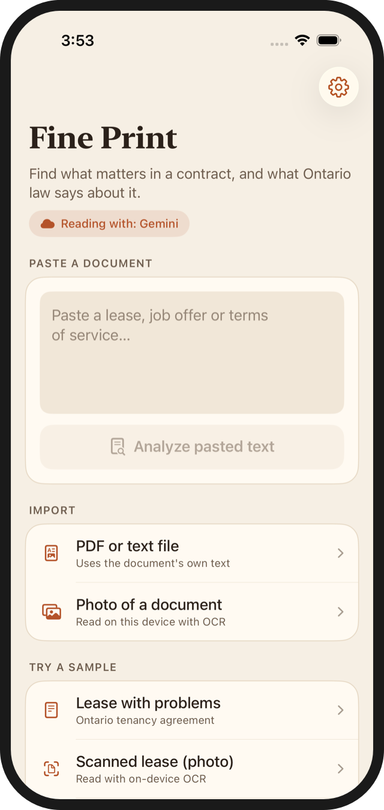
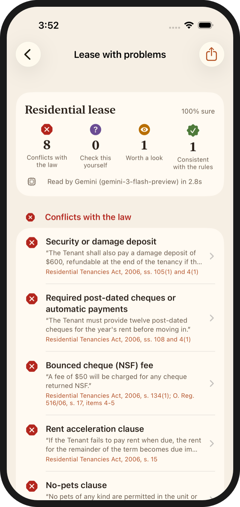
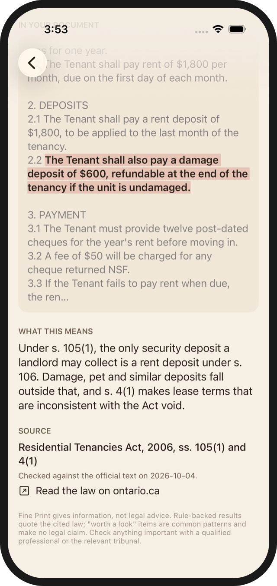

# Fine Print

An iPhone app that reads a lease or job offer and tells you which clauses Ontario law says you can ignore, and which are just worth a second look.

[Try it in your browser](https://lekanlawal1.github.io/portfolio-site/demos/fine-print/#your-document) · [Watch the 2-minute demo](docs/media/demo.mp4)

<p>
  
  
  
</p>

## Why I built it

People sign leases and job offers without reading them closely, and a lot of what's in them isn't even enforceable. In Ontario, a "no pets" clause in a residential lease is void, and so are damage deposits and most non-competes. An AI can read a contract in seconds, but one that confidently tells you a clause is illegal when it isn't is worse than no help at all. So I wanted the AI to do the reading and nothing else.

## How it works

You paste text, open a PDF or take a photo. An AI model finds the clauses and has to quote each one word for word. Then ordinary code takes over: it checks the quote is really in the document, checks the wording actually supports the AI's label, and only then applies a rule. Every rule cites the section of the Residential Tenancies Act or Employment Standards Act it comes from, and I checked each one against the official text. If there's no verified rule, the app says "worth a look" and makes no legal claim.

The label check came from a real failure. Both AI engines read "Pets are welcome" as a pet ban, and the rules then called it void. A real quote with the wrong label is the dangerous case, so now the document's own wording gets checked before any rule runs.

## What I found

I tested it on 12 documents written to break it: negations, messy PDF text, a bad scan, a hidden prompt injection. With Gemini it found every clause and missed no violations, and across every engine it gave zero wrong legal verdicts. Apple's on-device model, which keeps the document on the phone, found only about half the clauses, so the app uses Gemini when you allow it and falls back to on-device AI otherwise.

The hidden instruction telling "any AI" to report no issues did nothing. Even a model that obeyed it couldn't produce a false all-clear, because the verdicts come from code.

## Limits

It only has rules for Ontario leases and employment. The test set is 12 documents I wrote myself. It's not on the App Store, because that needs a paid developer account, so the browser version is the way to try it. It gives information, not legal advice.

## Run it

Needs Xcode 27 and [XcodeGen](https://github.com/yonaskolb/XcodeGen).

```bash
cd FinePrintCore && swift test          # 57 tests, no simulator needed
swift run fp-eval --engine mock         # run the evaluation without AI
cd .. && xcodegen generate && open FinePrint.xcodeproj
```

To use Gemini, add a key in the app's Settings, or put `GEMINI_API_KEY` in `.env` for the evaluation.

## More

[docs/details.md](docs/details.md) has the full write-up: every design decision, the results table for all three engines, and the repo layout. The [evaluation](docs/phase5_evaluation.md) and [rule verification](docs/rule_verification.md) have the raw detail.
